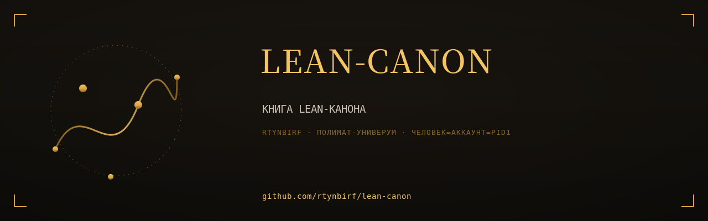

# КНИГА LEAN-КАНОНА

  

> Собрана 2026-11-11 из 2 репозиториев аккаунта rtynbirf. Каждая глава — снимок `main` оригинала на дату сборки (см. `PROVENANCE.md` внутри главы). Оригиналы архивированы read-only, история коммитов сохранена там.

**Книга несёт только чистовое: черновики и предыдущие редакции снесены из книги (по слову Хозяина 2026-11-11) и живут в архивных оригиналах.**

## Оглавление

| Глава | Источник | Файлов | Коммитов в ориг. | Снимок |
|---|---|---|---|---|
| [POLYMATH-ATLAS-GESTALT-CANON](glavy/POLYMATH-ATLAS-GESTALT-CANON/) | [оригинал](https://github.com/rtynbirf/POLYMATH-ATLAS-GESTALT-CANON) | 358 | 15 | `489debe` |
| [polymath-stckg-core](glavy/polymath-stckg-core/) | [оригинал](https://github.com/rtynbirf/polymath-stckg-core) | 161 | 23 | `f41d4e1` |

## О чём эта книга

Книга: Атлас в Lean 4 одним томом — три поколения Атласа и ST-CKG-мост, machine-verified, zero sorry. Собрано из 4 репозиториев rtynbirf.

## Как читать

Каждый каталог в `glavy/` — самостоятельная глава со своим README (если оно было в оригинале). Имена глав совпадают с именами исходных репозиториев.

## Канон

**Канон Lean-линии** — `POLYMATH-ATLAS-GESTALT-CANON` (301 модуль, 553 теоремы). Предыдущие поколения (`polymath-atlas` — 7 модулей; `polymath-atlas-v107`) снесены из книги по слову Хозяина «оставить чистовое, без черновиков» и живут в архивных оригиналах: https://github.com/rtynbirf/polymath-atlas · https://github.com/rtynbirf/polymath-atlas-v107
