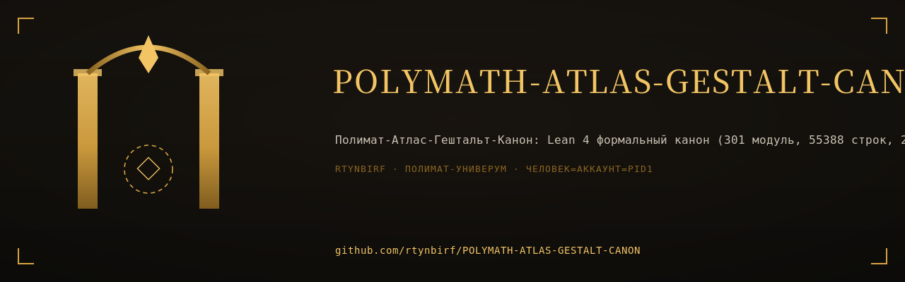

This project was edited by [Aristotle](https://aristotle.harmonic.fun).

To cite Aristotle:
- Tag @Aristotle-Harmonic on GitHub PRs/issues
- Add as co-author to commits:
```
Co-authored-by: Aristotle (Harmonic) <aristotle-harmonic@harmonic.fun>
```

<div align="center">

[](https://github.com/rtynbirf/POLYMATH-ATLAS-GESTALT-CANON/actions/workflows/ci.yml)
[](https://lean-lang.org)
[](https://github.com/leanprover-community/mathlib4)
[](CHARTER.md)
[](LICENSE)

**Дом = автомат.** Устав исполняет машина, а не память и не настроение.
</div>

# POLYMATH-ATLAS — формальное ядро модели знаний (Lean 4)

<div align="center">
  
</div>


Формализация ядра модели знаний из аудита POLYMATH-ATLAS: Knowledge Object,
Relation как самостоятельная сущность, граф знаний и граф доказательств,
с машинно-проверенными доказательствами ключевых свойств.

Соответствует пунктам 1–5 итогового приоритета действий аудита:
формальная модель Knowledge Object с чёткими типами (1), единый граф знаний
и граф доказательств (2), слой формальной верификации — вся модель живёт
внутри Lean 4 и проверена ядром (3), агентная архитектура с ролями
и протоколами (4), метаобучение и самоизменение (5), масштабирование
до коллективного уровня — слияние знаний нескольких агентов (6).

## Структура

| Файл | Содержание |
|---|---|
| `RequestProject/Core.lean` | `ObjectKind`, `Maturity`, `KnowledgeObject`, `RelationKind`, `KnowledgeRelation`, `KnowledgeGraph`; ссылочная целостность, нормализованность, удаление объекта, уверенность вдоль вывода |
| `RequestProject/Dependency.lean` | слой структурных зависимостей: `Dep`, `Reaches`, `Acyclic`, фундированность, фундамент, уровни/стратификация, `Impact` |
| `RequestProject/ProofGraph.lean` | `ProofGraph`, обоснованность `Grounded`, трассировка к аксиомам, отказ циклическим доказательствам, полнота верификации, мост «граф знаний → граф доказательств» |
| `RequestProject/Verification.lean` | **разрешимость верификации**: оператор вывода `step`, итерация `iterate`, вычисленное множество `groundedSet`; корректность и полнота (`mem_groundedSet_iff`), разрешимость `Grounded`, наименьшая неподвижная точка (`grounded_is_least_closed`), булев вердикт `verified` и мост `KnowledgeGraph.verifiedBy` |
| `RequestProject/Certificate.lean` | **сертификат обоснованности**: глубина вывода `derivRank`, строгое убывание по посылкам, отсутствие кругов среди обоснованных утверждений (`grounded_not_reaches_self`), порядок вывода `derivOrder` и его корректность (`exists_derivation_order`) |
| `RequestProject/Retraction.lean` | **отзыв утверждения** `retract`: точный критерий выживания обоснованности (`grounded_retract_iff`) и точность зоны поражения `{x} ∪ Impact x` (`retraction_impact_exact`) |
| `RequestProject/ExampleVerification.lean` | запуск алгоритма: демонстрационный граф ATLAS верифицируется (`decide`), граф с круговым обоснованием отвергается вместе с доказательством необоснованности |
| `RequestProject/Evolution.lean` | рост графа знаний (`addObject`, `addRelation`), версии модели (`Extends`), безопасность роста и монотонность обоснованности |
| `RequestProject/Agents.lean` | роли агентов, действия, права `Permitted`, легальный протокольный след `Legal` и его гарантии |
| `RequestProject/MetaLearning.lean` | самоизменение как оператор над графом, сохранение инвариантов, сходимость рекурсивного самоулучшения, границы самообоснования |
| `RequestProject/Collective.lean` | слияние графов знаний и графов доказательств разных агентов, конфликты, коллективная обоснованность |
| `RequestProject/Curriculum.lean` | траектория изучения: существование линейного порядка, согласованного со всеми зависимостями |
| `RequestProject/Dedup.lean` | дедупликация: выбор канонического представителя `CanonChoice`, операция `dedup` и её корректность |
| `RequestProject/ExampleDedup.lean` | конкретный граф с дублирующимся концептом и его дедупликация |
| `RequestProject/Scale.lean` | шкала масштабов `Scale`, башня графов знаний `KnowledgeTower` и башня графов доказательств `ProofTower`, уровень рождения знания, насыщение |
| `RequestProject/Cycle.lean` | единый цикл OBSERVE → … → EVOLVE: фазы `Phase`, накапливающие стадии оборота, обратная связь по обоснованному знанию |
| `RequestProject/ExampleScale.lean` | конкретная трёхуровневая башня знания и конкретный оборот цикла фаз |
| `RequestProject/Example.lean` | конкретный граф из трёх объектов, на котором все свойства проверены |
| `RequestProject/ExampleAgents.lean` | конкретный легальный протокольный след трёх агентов над этим графом |
| `RequestProject/AdaptiveAgent.lean` | нормализованное ядро адаптивного агента (слои L1–L7): `ObservationStream`, `Live`, `StreamTransformer`, `klDiv`, `VariationalFamily`, `ActivePolicyAgent`, `MetaOptimizer`, `AdaptivePreconditions`, `AdaptiveAgentSpec`, `ReflexiveAdaptiveAgent` |
| `RequestProject/ExampleAdaptiveAgent.lean` | конкретный рефлексивный адаптивный агент над `Bool` — проверка непустоты слоёв L1–L7 |
| `RequestProject/OSA/Spec.lean` | спецификация OSA-3.2: схема оператора (§2), иерархия типов L0–L4 (§3), уровни эффектов (§4), векторная неопределённость и пороги (§5), правила компиляции (§7), реестр кодов ошибок (§8), вычислимый компилятор `compile` и отчёт формата §9 |
| `RequestProject/OSA/Theorems.lean` | доказанные свойства компилятора: `PASS ⟺ пройдены все четыре уровня`, гарантии PASS по каждому правилу (типы, отсутствие прыжков через уровни, контракты, инварианты, авторизация E4/подтверждение E3, утечка эффектов, порог неопределённости), согласованность «код ↔ статус» реестра §8 |
| `RequestProject/OSA/Cases.lean` | каталог операторов (MEASURE, CALIBRATE, MODEL, SIMULATE, VALIDATE, VERIFY, DECIDE, AUTHORIZE, EXECUTE, …) и разобранные кейсы с вердиктами, доказанными вычислением; печать отчётов §9 |
| `RequestProject/OSA/CoreBridge.lean` | мост OSA → ядро модели знаний: композиция как граф знаний (`chainGraph`), структурность связей, корректность объектов, фундированность слоя зависимостей |
| `OSA_REPORTS.md` | вердикты компилятора по всем разобранным кейсам в формате §9 |
| `RequestProject/Main.lean` | точка входа и проверка используемых аксиом |

## Доказанные свойства

1. **Ссылочная целостность** (`KnowledgeGraph.relation_resolves`) — каждая связь
   разрешается в *единственный* объект-источник и *единственный* объект-цель:
   битых и неоднозначных ссылок не бывает по построению.
2. **Разделение слоёв связности** (`RelationKind.structural_ne_causal`) —
   причинный слой отделён от логического.
3. **Нормализация** (`KnowledgeGraph.Normalized`, `KnowledgeGraph.normalized_lookup_unique`,
   `KnowledgeGraph.eraseObj_normalized`) — «один концепт существует ровно один раз»:
   ссылка по имени однозначна, свойство наследуется подграфами.
4. **Безопасное удаление** (`KnowledgeGraph.eraseObj`,
   `KnowledgeGraph.eraseObj_relations_eq_of_no_impact`) — удаление объекта вместе
   с инцидентными связями снова даёт корректный граф; при пустом `Impact`
   связи не затрагиваются.
5. **Фундированность** (`KnowledgeGraph.wf_dep`, `KnowledgeGraph.dep_induction`) —
   в ациклическом графе спуск по зависимостям обрывается, доступна индукция
   по зависимостям.
6. **Существование фундамента** (`KnowledgeGraph.exists_foundation`) — непустой
   ациклический граф знаний всегда имеет аксиоматическое основание.
7. **Стратифицируемость** (`KnowledgeGraph.acyclic_iff_stratifiable`) — ацикличность
   равносильна разложению по уровням; сортировка по уровню даёт корректную
   траекторию изучения (Curriculum).
8. **Замкнутость доказательства** (`ProofGraph.grounded_of_reaches`,
   `ProofGraph.not_grounded_of_premise_not_grounded`) — обоснованность
   распространяется на всё дерево посылок; недоказанная лемма делает
   недоказанным и результат.
9. **Обратная трассировка** (`ProofGraph.grounded_trace`) — любое обоснованное
   утверждение приводит к аксиоме или базовому выводу.
10. **Отказ циклическим доказательствам** (`ProofGraph.not_grounded_of_circular`,
    `ProofGraph.not_grounded_self_loop`).
11. **Полнота верификации** (`ProofGraph.all_grounded_of_acyclic`,
    `KnowledgeGraph.all_grounded`) — ацикличный граф, где у каждого утверждения есть
    обоснование, обоснован целиком.
11a. **Разрешимость верификации** (`ProofGraph.mem_groundedSet_iff`,
    `ProofGraph.instDecidableGrounded`, `ProofGraph.verified_eq_true_iff`,
    `KnowledgeGraph.verifiedBy_eq_true_iff`) — обоснованность не просто
    определена, но и **вычислима**: итерация оператора вывода даёт в точности
    множество обоснованных утверждений (корректность и полнота), и вердикт
    верификации графа согласован с математическим определением. Кроме того,
    множество обоснованных утверждений — наименьшая неподвижная точка
    оператора вывода (`ProofGraph.grounded_is_least_closed`), а ложный вердикт
    равносилен существованию конкретного необоснованного утверждения
    (`ProofGraph.not_verified_iff_exists_ungrounded`).  Алгоритм запущен на
    примерах: `Demo.atlas_verifiedBy` (вердикт `true`) и `Demo.circular_not_verified`
    (круговое обоснование отвергается).
11b. **Сертификат и отсутствие кругов** (`ProofGraph.premise_derivRank_lt`,
    `ProofGraph.grounded_not_reaches_self`, `ProofGraph.exists_derivation_order`) —
    вердикта мало: для обоснованного графа строится **порядок вывода** —
    перечисление всех обоснованных утверждений без повторов, в котором посылки
    каждого стоят строго раньше него.  Отсюда же следует усиление п. 10:
    обоснованное утверждение **никогда** не участвует в собственном
    доказательстве — отсутствие круга теперь не предположение, а теорема.
11c. **Точная зона поражения при отзыве** (`ProofGraph.grounded_retract_iff`,
    `ProofGraph.retraction_impact_exact`) — если утверждение отозвано (больше не
    аксиома и не доказано), то обоснованность теряют **в точности** оно само
    и те, кто на него опирается (`{x} ∪ Impact x`) — не больше и не меньше;
    всё остальное переживает правку.
12. **Отсутствие «отмывания уверенности»** (`chainConfidence_le`).
13. **Безопасный рост знания** (`KnowledgeGraph.addObj_acyclic`,
    `KnowledgeGraph.addObj_normalized`, `KnowledgeGraph.addRel_acyclic`) — добавление объекта
    или связи снова даёт корректный граф; цикл не возникает, если новая связь
    не замыкает существующий путь зависимостей.
14. **Версии модели** (`KnowledgeGraph.Extends`, `ProofGraph.Extends`,
    `ProofGraph.grounded_mono`) — при переходе к новой версии ничего не теряется:
    объекты, зависимости и уже установленная обоснованность сохраняются.
15. **Гарантии агентного протокола** (`KnowledgeGraph.run_relation_resolves`,
    `KnowledgeGraph.run_normalized`, `KnowledgeGraph.run_acyclic`,
    `KnowledgeGraph.run_allWellFormed`) — любой легальный след действий агентов
    сохраняет ссылочную целостность, нормализованность, ацикличность
    и корректность объектов.
16. **Никакой канонизации без верификатора**
    (`KnowledgeGraph.run_canonicalIds_subset`) — статус `canonical`/`axiom` может
    появиться только в результате действия агента-верификатора; аксиомой
    объявляется лишь знание с уверенностью `1`.
17. **Самоизменение сохраняет инварианты** (`iterate_invariant`,
    `iterate_acyclic`, `iterate_normalized`).
18. **Сходимость рекурсивного самоулучшения** (`selfImprovement_stabilizes`) —
    монотонный оператор внутри конечного универсума за конечное число шагов
    достигает неподвижной точки.
19. **Границы самообоснования** (`ProofGraph.not_grounded_of_self_reaching`) —
    система не может обосновать правило ссылкой на него же.
20. **Корректное слияние знаний** (`KnowledgeGraph.merge`, `KnowledgeGraph.merge_extends_left`,
    `KnowledgeGraph.merge_dep`, `KnowledgeGraph.merge_normalized`,
    `KnowledgeGraph.merge_acyclic_of_rank`) — объединение знаний совместимых агентов
    снова даёт корректный граф, расширяющий обе части; при общей
    стратификации оно ациклично.
21. **Конфликты не возникают из ниоткуда** (`KnowledgeGraph.merge_conflict`,
    `KnowledgeGraph.merge_conflictFree`) — любое заявленное противоречие общего
    знания уже присутствовало у одного из агентов.
22. **Коллективное знание не теряет обоснований**
    (`ProofGraph.grounded_merge_left`, `ProofGraph.grounded_merge_right`).
23. **Корректная траектория изучения** (`KnowledgeGraph.Curriculum`,
    `KnowledgeGraph.exists_curriculum`) — объекты любого ациклического графа
    знаний выстраиваются в последовательность, в которой каждая предпосылка
    изучается строго раньше того, что на неё опирается.
24. **Монотонность знания по масштабам** (`Scale`, `KnowledgeTower`,
    `KnowledgeTower.extends_of_le`, `KnowledgeTower.dep_of_le`, `KnowledgeTower.reaches_of_le`) —
    переход на более высокий уровень (индивид → коллектив →
    цивилизация → … → метауровень) интегрирует, а не переписывает
    знание нижних уровней.
25. **Верхний уровень не прячет противоречий** (`KnowledgeTower.acyclic_of_le`,
    `KnowledgeTower.normalized_of_le`) — ацикличность и нормализованность
    верхнего уровня наследуются всеми нижними.
26. **Уровень рождения знания** (`KnowledgeTower.exists_birth`,
    `KnowledgeTower.exists_birth_rel`) — у каждого объекта и каждой связи есть
    минимальный уровень появления, выше которого они присутствуют
    всегда.
27. **Насыщение башни** (`KnowledgeTower.saturates`,
    `ProofTower.groundedClaims_saturates`) — в конечном универсуме рост
    знания по уровням и рост обоснованного знания обрываются за
    конечное число шагов.
28. **Обоснованность живёт вверх по масштабам** (`ProofTower.grounded_of_le`,
    `ProofTower.premises_eq_of_le`) — доказанное на одном уровне остаётся
    доказанным на всех более высоких, а уже зафиксированные
    посылки не переписываются.
29. **Замкнутость единого цикла** (`Phase.next_iterate_eight`,
    `Phase.next_bijective`, `Phase.reachable`) — цикл OBSERVE → … → EVOLVE
    замыкается за восемь шагов, переход между фазами — биекция
    (нет ни тупиков, ни развилок), и любая фаза достижима из любой.
30. **Оборот цикла только накапливает знание** (`cycleRun`,
    `cycleRun_accumulating`, `cycleRun_invariant`, `KnowledgeTower.ofAccumulating`,
    `cycle_stabilizes`) — композиция стадий сохраняет инварианты,
    порождает башню знания и в конечном универсуме выходит на
    неподвижную точку.
31. **Обратная связь не разрушает знания** (`ProofGraph.groundedClaims`,
    `ProofGraph.groundedClaims_mono`) — множество обоснованных утверждений
    вдоль цикла только растёт.
32. **Нормальная форма графа знаний** (`KnowledgeGraph.CanonChoice`, `KnowledgeGraph.dedup`,
    `KnowledgeGraph.dedup_normalized`, `KnowledgeGraph.dedup_dep_iff`,
    `KnowledgeGraph.dedup_acyclic_of_rank`, `KnowledgeGraph.dedup_objects_eq_of_normalized`) —
    дублирующееся знание можно не только запретить, но и устранить:
    дедупликация даёт корректный нормализованный граф, сохраняет все
    зависимости и не создаёт новых, не создаёт циклов при
    согласованности с уровнями и идемпотентна на уже нормализованных
    графах.
33. **Непустота модели** (`Demo.atlas_all_grounded`, `Demo.trace_legal`,
    `Demo.traceNoVer_no_canonization`, `Demo.atlasMerged_conflictFree`,
    `Demo.demoTower_acyclic`, `Demo.demoTower_saturated`,
    `Demo.atlasDup_not_normalized`, `Demo.atlasDedup_normalized`) — все
    свойства проверены на конкретном графе, конкретном протокольном следе,
    конкретном слиянии знаний двух агентов, конкретной трёхуровневой
    башне знания и конкретном устранении дублирующегося концепта.  Кроме
    того, алгоритм верификации *исполнен* на примерах
    (`Demo.atlas_verifiedBy`, `Demo.atlas_retract_axiom_groundedSet`,
    `Demo.circular_not_verified`) — все три утверждения закрыты вычислением.

## Сборка

```
lake build
```

Все результаты доказаны без `sorry`; используемые аксиомы —
только стандартные `propext`, `Classical.choice`, `Quot.sound`
(проверяется командами `#print axioms` в `RequestProject/Main.lean`).

## Исполняемое ядро: адаптивные системы обработки информации

Модуль `RequestProject/UCC.lean` (пространство имён `PolymathAtlas.Core`)
самодостаточен: он импортирует только Mathlib и не зависит от остальных
файлов проекта. В нём определены `Distinction`, `State` (список пар
имя–значение, равенство с точностью до перестановки), `Transition`,
`informationGain`, `Model`, `Goal`, `feedbackError` и один шаг
универсального цикла познания `uccStep` (предсказание → сравнение →
обновление модели → выбор следующего состояния).

Доказано:

* `distinction_nontrivial` (T1) — различение нетривиально: `inside ≠ outside`;
* `informationGain_eq_zero_iff` (T2) — прирост информации равен нулю тогда и
  только тогда, когда состояния совпадают с точностью до перестановки;
* `feedback_zero_of_eq` (T3) — верное предсказание даёт нулевую ошибку;
* `uccStep_perfect` (T4) — при уже точной модели, подтверждающем наблюдении и
  достигнутой цели шаг цикла ничего не меняет: модель та же, состояние то же,
  цель выполнена, ошибка остаётся нулевой;
* `uccStep_error_zero` — после любого шага ошибка модели в текущем состоянии
  равна нулю (цикл действительно минимизирует ошибку предсказания);
* `ucc_eventually_cycles` (T5) — на конечном, замкнутом относительно среды
  пространстве состояний траектория системы с точной моделью повторяет
  конфигурацию не позже чем через `|S|` шагов (неподвижная точка или цикл);
  общая лемма о «принципе Дирихле» `exists_iterate_eq_of_finite` доказана
  в полной общности.

Сознательные ослабления перечислены в комментарии в начале файла: измерение
информации ведётся на мультимножествах привязок (иначе T2 не была бы
равносильностью), `uccStep` требует разрешимости цели `[DecidablePred g]`,
а T5 формулируется для модели, точной относительно среды.


## Нормализация имён

Имена приведены к соглашениям Mathlib: идентификатор описывает формальный
объект, а не метафору. Полный список переименований — в `RENAME_LOG.md`
(`KGraph → KnowledgeGraph`, `PGraph → ProofGraph`, `KObj → KnowledgeObject`,
`Rel → KnowledgeRelation`, `Tower → KnowledgeTower` и т. д.).

## Слои адаптивного агента L1–L7

Модуль `RequestProject/AdaptiveAgent.lean` (пространство имён
`PolymathAtlas.AdaptiveAgent`) импортирует только Mathlib. В нём:

* **L1** — поток наблюдений `ObservationStream`, живучесть `LiveAt`/`Live`,
  преобразователи потоков `StreamTransformer`; доказано, что живучесть
  равносильна бесконечности множества активных моментов
  (`live_iff_setOf_active_infinite`) и что она сохраняется при усечении
  (`live_truncate_of_live`);
* **L2** — относительная энтропия `klDiv` и неравенство Гиббса
  `klDiv_nonneg`, вариационное семейство `VariationalFamily`,
  неотрицательность сложности `complexity_nonneg`, оценка непрерывности
  `KLContinuityBound`;
* **L3** — агент активного вывода `ActivePolicyAgent`, ожидаемая свободная
  энергия `efe` и её неотрицательность `efe_nonneg`, накопление вдоль плана
  `efe_foldl_nonneg_of_init_nonneg`, траектории `trajectory`;
* **L4** — эндоотображения `SelfMap`/`Endomap`, метаоптимизатор
  `MetaOptimizer`; теорема Кнастера–Тарского `exists_fixed_point_selfMap`
  и опровержение неограниченной формы
  `not_forall_exists_fixed_point_selfMap` (у `Bool.not` нет неподвижной
  точки) — поэтому никакая аксиома существования не нужна;
* **L5–L6** — три предусловия `AdaptivePreconditions` и спецификация из пяти
  условий `AdaptiveAgentSpec` вместе с теоремами о том, что отказ любого
  условия опровергает целое;
* **L7** — рефлексивное замыкание `ReflexiveAdaptiveAgent`: агент, являющийся
  неподвижной точкой собственного метаобновления; доказано
  `self_nontrivial` (самоописание вынуждает нетривиальность латентного
  пространства).

Непустота всех слоёв проверена на конкретном агенте в
`RequestProject/ExampleAdaptiveAgent.lean`.

## POLYMATH_ATLAS_GESTALT — формализация (полностью доказано)

Семь модулей в `RequestProject/Gestalt/`, собранных агрегатором
`RequestProject/Gestalt.lean`:

| Файл | Содержание |
| --- | --- |
| `Gestalt/UCC.lean` | Universal Cognition Cycle: T1 Distinction, T2 informationGain, T3 feedbackError, T4 perfectPredictInert, T5 pigeonholeRevisit |
| `Gestalt/GenesisEngine.lean` | Слои Genesis Engine L1–L7 (`DistinctionDetector`, `DistinctionFilter`, `Navigator`/EFE, `Monitor`, `GenesisConditions`, `MinimalIntelligence`, `StateSpaceExpansion`) |
| `Gestalt/SelfReference.lean` | `methodology_revisits_level`, `ideal_is_death` («идеал = смерть»), `gap_preserves_life` («щель») |
| `Gestalt/MetaSkills.lean` | `Metacognition`, `IdiotesAgent`, `prompt_cannot_install_metacognition` |
| `Gestalt/ToolInventory.lean` | `tool_has`, `tool_missing_critical`, `tool_desirable`, `idiotes_tools` |
| `Gestalt/AristotleCanon.lean` | `aristotle_is_polymath_practice`, `HorizonCanon` (правило сдвига) |
| `Gestalt/CoreBridge.lean` | мост к ядру: EFE-навигатор из `ActivePolicyAgent`, Ω как неподвижная точка, T1-различение рефлексивного агента |

Все утверждения доказаны полностью: `sorry` не осталось. Каждое утверждение
снабжено докстрингом с указанием источника. Ни одной новой аксиомы: каждый постулат
неформального источника оформлен как поле `structure`. Проект собирается
(`lake build`) без ошибок. Подробная карта «неформальный пункт → декларация» —
в `GESTALT_SKELETON.md`; след аксиом всех 68 теорем — в `AXIOMS_REPORT.md`;
конечные модели-зеркала на `Bool` / `Fin 3` — в `runtime/gestalt_verification.py`.

## Кольцо эквивалентности RegExp ↔ ε-NFA ↔ NFA ↔ DFA ↔ MinDFA

Четыре новых модуля в `RequestProject/` замыкают кольцо переходов между
представлениями регулярных языков; каждый переход снабжён доказанной теоремой
корректности.

| Файл | Содержание |
| --- | --- |
| `UAM_MyhillNerode.lean` | отношение неразличимости `MyhillNerodeEquiv`, его эквивалентность и правая конгруэнция, опровержение «левой» конгруэнции, связь с DFA, конечность индекса, теорема Майхилла–Нероуда, единственность минимального DFA |
| `UAM_SubsetConstruction.lean` | ε-замыкание, устранение ε-переходов `epsilonRemoval`, подмножественное построение `subsetConstruction` и их корректность, композиция ε-NFA → DFA |
| `UAM_Minimization.lean` | `minimizeDFA`, корректность, приведённость, минимальность `minimize_minimal`, единственность с точностью до переименования |
| `UAM_Ring.lean` | шесть переходов кольца в одном месте, полный оборот `regexRoundTrip_language`, критерий регулярности через конечный индекс |

Ключевые результаты:

1. `myhill_nerode_refl` / `myhill_nerode_symm` / `myhill_nerode_trans` /
   `myhill_nerode_equivalence` — неразличимость есть отношение эквивалентности;
2. `myhill_nerode_congr` — **правая** конгруэнция: `x ≈_L y → (x ++ [a]) ≈_L (y ++ [a])`;
   «левая» форма `x ≈_L y → (a :: x) ≈_L (a :: y)` **ложна**, что доказано в
   `not_myhill_nerode_cons_congr` с явным контрпримером;
3. `dfa_respects_myhill_nerode` — равенство состояний влечёт неразличимость;
   обратное для произвольного DFA неверно (`twoStateDFA_not_reflects_myhill_nerode`);
4. `dfa_finite_index` — индекс `≈_L` не превосходит числа состояний DFA;
5. `myhill_nerode_finite_iff_regular` — конечность индекса ⟺ распознаваемость
   конечным DFA;
6. `minimal_dfa_unique_up_to_iso`, `minimize_unique_up_to_rename` — единственность
   минимального автомата с точностью до изоморфизма;
7. `subset_construction_correct`, `epsilon_removal_correct`,
   `epsilonNFAToDFA_correct` — корректность детерминизации;
8. `minimize_correct`, `minimize_minimal` — корректность и минимальность
   минимизации;
9. `regexRoundTrip_language` — полный оборот кольца сохраняет язык;
10. `regular_iff_finite_myhill_nerode_index` — регулярность ⟺ конечный индекс.

Все проверки аксиом собраны в `RequestProject/Main.lean`: используются только
`propext`, `Classical.choice`, `Quot.sound`.

## OSA-4.0 — семантическое ядро (новый слой)

Кодексы OSA-4.0 (`POLYMATH_ATLAS_OSA4_*.pdf`) описывают ядро, которое ранее в
проекте формализовано не было: слой `RequestProject/OSA/` покрывает
предшествующую версию OSA-3.2, помеченную самими кодексами как `LEGACY`.
Новый слой — `RequestProject/OSA4/` (агрегатор `OSA4/Index.lean`).

| Файл | Содержание |
| --- | --- |
| `OSA4/Axes.lean` | пять ортогональных осей (Категория, Роль, Абстракция, Тип, Фаза), решётка типов, LAW-001/002, ортогональность осей |
| `OSA4/Epistemic.lean` | таблица слияния ветвей кодекса, доказательство её **неассоциативности**, исправленная алгебра свидетельств `Belief` (LAW-013/014/015), T05/T08/T09 |
| `OSA4/Kernel.lean` | предикаты и их четырёхзначная семантика, состояние («нет записи ⇒ UNKNOWN»), операторы, **WP-трансформер** (LAW-012), LAW-003/006/010/017 |
| `OSA4/Identity.lean` | Recreation ≠ Resurrection: LAW-004/005/016, T04a/T04b/T12 |
| `OSA4/Effects.lean` | агрегация эффектов как коммутативный идемпотентный моноид (LAW-008), авторизация (LAW-011), запрет эпистемического самоповышения (LAW-009) |
| `OSA4/Repair.lean` | лексикографический оптимизатор ремонта, доминирование безопасности, LAW-018 |
| `OSA4/Compiler.lean` | вычислимый компилятор цепочек: реестр, живучесть, однократное потребление, вердикты PASS/REJECT/REPAIR/UNDECIDABLE |
| `OSA4/TortureSet.lean` | Semantic Torture Set T01–T15: вердикты **вычислены**, а не заявлены |
| `OSA4/Lawbook.lean` | все 18 законов ядра как доказанные утверждения (`lawbook_holds`), без новых аксиом |
| `OSA4/Pipeline.lean` | инженерный конвейер v5: обязательный человеческий шлюз, «LLM не управляет графом», локальный context pack |
| `OSA4/BasisWitnesses.lean` | конкретные доказанные свидетели позиций базисного набора §13 |
| `OSA4/Basis.lean` | машинный учёт покрытия минимального базисного набора §13: закрыты все 90 позиций (`coverage_complete`) |
| `OSA4/ModelCheck.lean` | MODEL CHECK ядра: исчерпывающий перебор законов на конечных областях (алгебры `PT`, `EffectLevel`, `Belief`; 25 миров × 12 шагов; 6 операторов × 6 состояний × 11 предикатов; набор сценариев компилятора) |
| `OSA4/MetaSchema.lean` | замыкание Kernel v0.4 (`kernel_v04_closed`) и Atlas S-1.0 Meta-Schema: обменный формат и доказанная точность сериализации предикатов, операторов, состояний и цепочек (`metaSchema_is_faithful_serialization`) |

Ключевой результат аудита: напечатанная в кодексе пятизначная таблица слияния
ветвей **не ассоциативна** (`joinSpec_not_assoc`, ровно восемь неассоциативных
троек), хотя коммутативна и идемпотентна. Исправление — разведение presence и
truth (`Belief`), при котором полурешёточные законы становятся теоремами, а
вердикты Torture Set сохраняются; расхождение с напечатанной таблицей — ровно
шесть клеток в строке/столбце `UNKNOWN` (`spec_disagreement_eq`).

Вторая находка — уже этапа MODEL CHECK: четырёхзначная алгебра предикатов `PT`
идемпотентна, коммутативна, ассоциативна и удовлетворяет законам де Моргана, но
**не дистрибутивна** и не удовлетворяет закону поглощения
(`pt_and_not_distrib_or`); нарушающих троек ровно две, и обе — на встрече
`UNKNOWN` с `CONFLICT` (`pt_distrib_failures_eq`).  На фрагменте без `CONFLICT`
алгебра замкнута и является дистрибутивной решёткой
(`pt_conflict_free_closed`, `pt_conflict_free_distrib`,
`pt_conflict_free_absorption`), то есть дефект проявляется только после того,
как противоречие уже зафиксировано.

| `OSA4/Spaces.lean` | пять пространств как индексированное семейство `Axis.Carrier`; артефакт ≡ набор координат (`artifactEquivCoords`); ортогональность как определённый предикат (`Orthogonal`, `artifact_orthogonal`) |
| `OSA4/Invariants.lean` | пространство инвариантов: `Invariant`, сохранение оператором, WP-критерий (`preserves_iff_wp`), сохранение композицией, корректный и полный детектор нарушений (`chainViolation_eq_none_iff`) |
| `OSA4/Criteria.lean` | формальные критерии вместо оценочной лексики: `Entails`/`StrictlyStronger`, `EffectLevel.Severer`, `UStep.Reduces`/`UWithin`, `Untouched`, `RVec.Better`; семантическая корректность вердикта PASS (`pass_chain_executable`) |
| `OSA4/Registry.lean` | реестр терминов (`termCatalogue`, 63 декларации), реестр утверждений (`statements_hold`), открытые вопросы `[OPEN]` (`OpenId.statement`), тесты и контрпримеры |

Полная ревизия «что отсутствовало и что осталось» — в `OSA4_GAP_ANALYSIS.md`;
отчёт формальной верификации терминологии и формулировок ядра —
в `OSA4_FORMAL_VERIFICATION_REPORT.md`.

### Слой аудита OSA-4.0 (`RequestProject/OSA4/Audit/`)

Независимая проверка ядра: непротиворечивость законов, мосты, система типов,
операторы, эффекты, генератор свидетелей и полный прогон Semantic Torture Set.

| файл | содержание |
|------|------------|
| `OSA4/Audit/TypeSystem.lean` | антисимметрия подтипизации: опровержение в общем виде (`isSubtype_not_antisymmetric`), достаточное условие `Graded` (`antisymmetric_of_graded`), валидация рабочей решётки `CalibratedValue ⊑ MeasuredValue ⊑ Datum` |
| `OSA4/Audit/Effects.lean` | `unitEffect = E0`, `aggregate [] = unitEffect`, нейтральность и **единственность** единицы, коммутативный идемпотентный моноид, ранг агрегата как максимум |
| `OSA4/Audit/Operators.lean` | `.consume` (допустим ⟺ `Available`, необратим, делает факт `UNKNOWN`) и `.recreate` (требует `Destroyed` и свободного ID, не воскрешает), frame-свойства |
| `OSA4/Audit/Bridges.lean` | Bridge 1 – Bridge 4 и их совместная валидность (`bridges_valid`, `bridge4_nonvacuous`) |
| `OSA4/Audit/Witness.lean` | реестр из 28 свидетелей, его корректность (`witnessTable_wf`), отсутствие самозависимости и циклов, завершаемость (`resolve_terminates`), топологический порядок выдачи (`generateWitnesses_deps_precede`) |
| `OSA4/Audit/Consistency.lean` | непротиворечивость свода (`lawbook_consistent`), ацикличность графа зависимостей законов (`lawDeps_acyclic`), ответы на пять критических вопросов (`q1`–`q5`), уточнённый критерий починки `repairForSound` |
| `OSA4/Audit/Torture20.lean` | тесты T01–T20 как утверждения: `torture_all_pass`, `torture_card = 20`, `torture_no_failures` |
| `OSA4/Audit.lean` | сводный вердикт аудита `osa4_audit_report` |

Развёрнутый отчёт аудита (постатейный разбор законов, разбор каждого теста,
границы проверки, находки и рекомендации) — в `OSA4_AUDIT_REPORT.md`.

### Слой OSA-5.0 и расширения аудита (2026)

Полный отчёт формального аудита проекта — в `POLYMATH_ATLAS_FULL_AUDIT.md`.

| файл | содержание |
|------|------------|
| `OSA4/Audit/Integration.lean` | шесть интеграционных тестов аудита как проверяемые утверждения (`integration_all_pass`), явный топологический порядок графа обоснований законов (`topological_sort_exists`) |
| `OSA5/Repair.lean` | **многошаговый ремонт**: поиск плана произвольной длины `searchRepair` (тотальный, по топливу), корректность (`searchRepair_sound`), полнота (`searchRepair_complete`, `searchRepair_isSome_iff`), минимальный план (`minRepair`), полнота починки — после вставки плана цепочка компилируется в `PASS` (`repaired_chain_compiles_pass`) |
| `OSA5/Torture25.lean` | сводный набор T01–T25 (`torture25_all_pass`, `torture25_card = 25`) |
| `Gestalt/HolographicScanner.lean` | Gestalt L4/L5: голографический сканер и точность реконструкции (`Faithful`, `no_faithful_scanner_of_card_lt`), Genesis Conditions и вывод адаптивных предусловий (`genesis_implies_preconditions`) |
| `UAM_ContextFree.lean` | контекстно-свободные грамматики, автоматы с магазинной памятью, эквивалентность `contextFree_iff_pda`, пример `aⁿbⁿ` |
| `UAM_ContextFreePumping.lean` | механизм накачки: `SelfEmbedding`, `pump`, `pump_language`, бесконечность языка (`language_infinite_of_selfEmbedding`) |
| `Bridges/RegularContextFree.lean` | регулярные языки как подкласс контекстно-свободных (`regular_subset_contextFree`, `regular_subset_pda`) |
| `Bridges/GestaltAdaptiveAgent.lean` | Bridge 2: двусторонний мост Gestalt UCC ↔ адаптивный агент (`bridge2_two_sided`) |
| `Bridges/OSA_UAM.lean` | Bridge 3: цепочки операторов OSA как свободный моноид, гомоморфизм Кэли, правая конгруэнция Майхилла–Нероуда |
| `Bridges/GestaltUAM.lean` | Bridge 5: когнитивный цикл UCC через DFA (`trajectory_eq_evalFrom`, `dfa_revisits`) |
| `Examples/DataPipeline.lean` | конкретный ETL-конвейер: шесть режимов вердикта компилятора и многошаговый ремонт, вычисленные ядром |

### Слой верификации (2026-08)

| файл | содержание |
|------|------------|
| `AuditChecks.lean` | исполнимые проверки протокола верификации: 27 булевых проверок (Torture Set ядра, Gold Dataset, базис §13, Meta-Schema, нетривиальность компилятора) с доказательством `allBoolChecks_pass`; отдельно — `#print axioms` для утверждений, которые вычислением проверить нельзя |
| `OSA4/OpenQuestions.lean` | закрытие трёх открытых вопросов OSA-4.0: O01 и O02 опровергнуты контрпримерами (`O01_repair_completeness_fails`, `O02_undecidable_resolvable_fails`), O03 доказан (`O03_liveness_completeness_holds`); для O01 и O02 доказаны исправленные формулировки |

Gold Dataset расширен с 15 до 25 кейсов (`OSA/Gold.lean`): исходные 15
сохранены как `goldDatasetV01`, добавлены `ENG016`–`SAF025` по доменам ENG,
IT, ML, SCI, BIZ, SAF; вердикт каждого доказан `by decide`.

Сводный отчёт о верификации — в `POLYMATH_ATLAS_VERIFICATION_REPORT.md`.

---

## ДОМ = АВТОМАТ (Устав + CANON-AUTOMATON)

Дом управляется Уставом (**[CHARTER.md](CHARTER.md)**) и автоматом
`CANON-AUTOMATON` (GitHub Actions). Состояние дома — конечный автомат
`{ЧИСТО, ГРЯЗНО}`; инвариант: `main` всегда ЧИСТО.

| Гейт | Что делает |
|---|---|
| G-build | `lake build` всех модулей дома (lean-action + Mathlib-кэш) |
| G-sweep | аксиомный след **каждой константы каждого модуля** ⊆ `{propext, Classical.choice, Quot.sound}` — через `Lean.collectAxioms`, не grep; ловит `sorryAx`, `Lean.ofReduceBool`, самодельные `axiom` |
| G-report | текстовые запреты Устава + отчёт `docs/auto/CANON_REPORT.md` (артефакт каждого прогона) |
| G-mirror | вычислимые свидетели слоя Gestalt согласны с Lean |

Сторож свежести (`watchdog.yml`) еженедельно сверяет пин дома с релизами Lean
и открывает issue, если мир ушёл вперёд. Апгрейд — отдельная операция
перекрёстной проверки (Устав §10).

### Локальная сборка

```bash
elan toolchain install $(cat lean-toolchain)
lake build
python3 scripts/gen_sweep.py > scripts/AxiomSweepGenerated.lean
lake env lean scripts/AxiomSweepGenerated.lean
python3 scripts/charter_report.py
python3 runtime/gestalt_verification.py
```

### Навигация по дому

| Путь | Что там |
|---|---|
| `RequestProject/` | канон: 301 Lean-модуль (Atlas · OSA/OSA4/OSA5 · Gestalt · Bridges · AtlasKO · UAM) |
| `CHARTER.md` | Устав дома: стратификация истины, аксиомная дисциплина, реестр расхождений |
| `reports/` | исторические аудиты и сводные отчёты |
| `docs/`, `docs/pdf/` | архитектурные документы, PDF-кодексы и досье |
| `runtime/` | вычислимое зеркало Gestalt (свидетели теорем) |
| `scripts/` | автомат-страж: генератор свипа, канонический отчёт, сторож |
